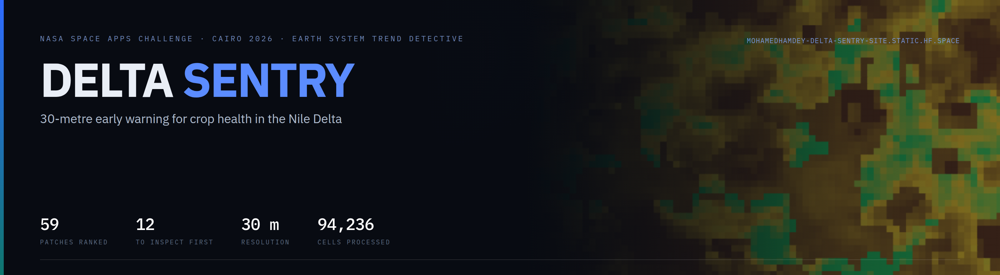
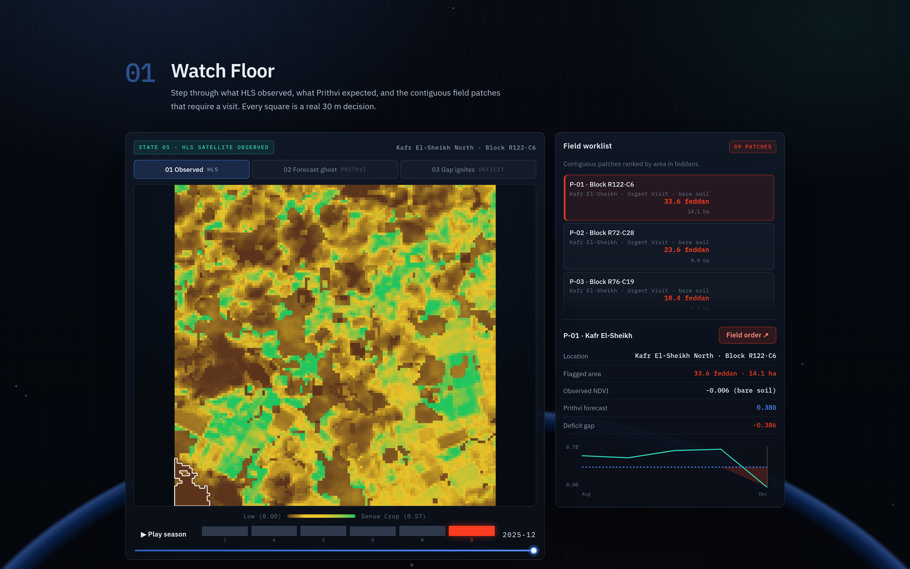
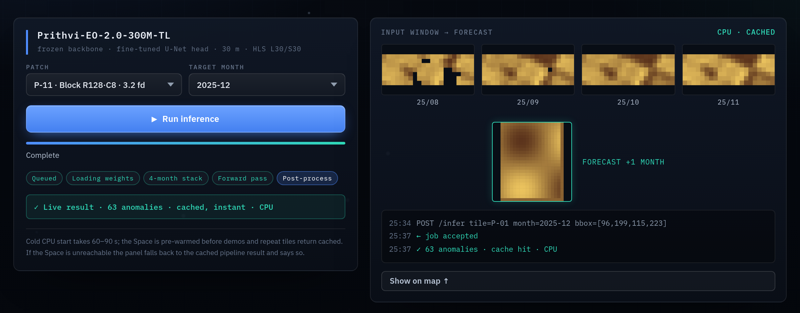
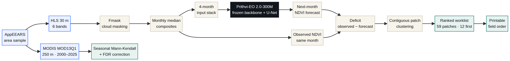
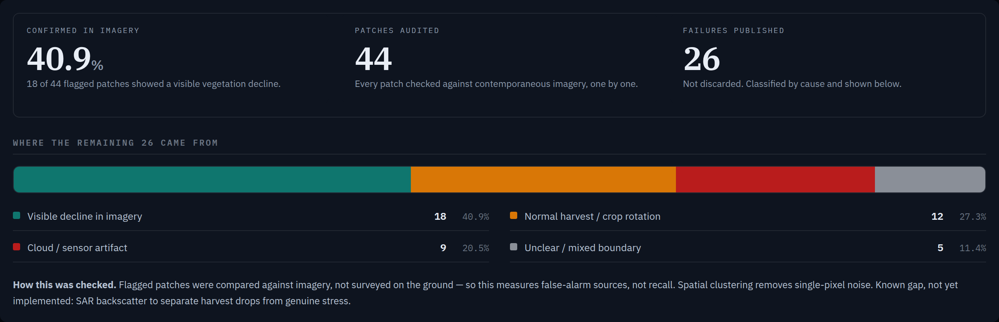

<p align="center">
  <b>An early-warning system that tells a Ministry of Agriculture inspector which twelve fields to visit this week.</b><br>
  30 m satellite imagery · NASA Prithvi-EO foundation model · one ranked, printable field order.
</p>

<p align="center">
  <a href="https://mohamedhamdey-delta-sentry-site.static.hf.space"></a>
  
  
</p>

<p align="center">
  
  
  
  
  
  
</p>

---

## Read this in 60 seconds

| | |
|---|---|
| **What it is** | A working web app that forecasts next month's vegetation at 30 m and converts the forecast error into a ranked list of field blocks to inspect. |
| **Who it is for** | A district agronomist with a vehicle, a phone and more fields than time. |
| **Why it matters** | District averages hide field-level failure. The missing step between a satellite map and a decision is a short list. |
| **What is proven** | The pipeline runs end to end on real NASA data, and the alert layer was audited patch by patch: **44 checked, 18 confirmed, 26 published as wrong.** |
| **What is not proven** | It does not beat seasonal climatology on global error, and it covers **one tile**, not the Delta. Both are stated below, not buried. |

---

## The problem

Egypt grows its food on a thin strip of irrigated land along the Nile. When a block of fields starts to fail, the district average does not move — a governorate mean stays flat while a hundred hectares go under. By the time the loss is visible from the road, it is already a compensation claim.

Satellite monitoring of Egyptian agriculture is not new. What is missing is the step between a map and a decision. A district agronomist cannot act on a raster of NDVI values. They can act on a short list with a place, an area and a reason.

**Delta Sentry is built around that conversion** — and around the difference between *"this field looks wrong"* and *"this field has failed."* The first is what a satellite can tell you. The second needs a person standing in the field. The product is designed to get that person to the right field.

---

## What it does



*The Watch Floor: what HLS observed at 30 m on the left, the ranked worklist on the right. 59 contiguous deficit patches, 175 feddan, 12 flagged for first visit. Selecting a patch opens its detail card and a printable field order.*

Four screens, in the order an inspector would use them:

1. **Brief** — the verdict for the district: how many patches, how much area, how many to inspect first.
2. **Watch Floor** — the map, the ranked worklist, and a printable field order with coordinates and an observation checklist.
3. **Try the model** — pick a patch, pick a month, run the fine-tuned Prithvi model live from the browser.
4. **Evidence Room** — the validation numbers, the 44-patch audit, the 25-year trend, and the limits.



*Live inference, not a recording. The run below returned 63 anomalies in 1.5 s on CPU and wrote the result back into the map above.*

---

## How it works



**The main task, in one line.** *In:* four months of 30 m satellite imagery for one tile. *Process:* forecast the fifth month, then measure the disagreement with reality. *Out:* a ranked list of field patches with area, coordinates and a printable inspection order.

| Step | What happens |
|---|---|
| **1 · Acquire** | AppEEARS area sample over Kafr El-Sheikh → HLS (HLSL30 + HLSS30) and MODIS MOD13Q1 as NetCDF. |
| **2 · Composite** | Fmask cloud masking per scene → monthly median composites → NDVI from red and NIR. |
| **3 · Forecast** | 4-month input stack → Prithvi-EO-2.0-300M (frozen backbone) + trained U-Net decoder → next-month NDVI. |
| **4 · Compare** | Forecast subtracted from the observed composite. Negative gaps are deficits. |
| **5 · Rank** | Deficits clustered into contiguous patches, ranked by area, exported as a field order. |
| **6 · Audit** | Flagged patches checked against high-resolution imagery; every false alarm classified and published. |

---

## Results — including the ones that lose

Trained on 500 spatial–temporal samples spanning 2013–2023, evaluated on held-out 2025 data.

| Baseline | RMSE ↓ | MAE ↓ | Verdict |
|---|---|---|---|
| Seasonal climatology | **0.1767** | **0.1393** | Strongest baseline. Beats us on both metrics. |
| Persistence (copy last month) | 0.1858 | 0.1320 | We beat it on RMSE by **1.9%**; it beats us on MAE. |
| **Prithvi B3 (ours)** | 0.1823 | 0.1505 | Second of three on RMSE, third of three on MAE. |

> **What we do not claim.** We do not beat seasonal climatology on global error, and we do not beat persistence on mean absolute error. A 12-year same-month climatology is a genuinely strong baseline for a seasonal signal, and a one-month-ahead forecast is not the right instrument for beating it.
>
> What we claim is narrower and testable: **the model produces a spatial ranking that a climatology cannot**, because a climatology is by construction smooth across space. A district average and a climatology are both blind to *which* field is failing. That is the gap this project fills.

### The field audit



We audited 44 flagged patches one by one against contemporaneous high-resolution imagery:

| Result | Count | Share |
|---|---|---|
| Visible vegetation decline | 18 | 40.9% |
| Normal harvest / crop rotation | 12 | 27.3% |
| Cloud or sensor artefact | 9 | 20.5% |
| Unclear / mixed boundary | 5 | 11.4% |

The 26 failures are published rather than discarded, because **a false-alarm rate is the number a Ministry needs before trusting a list.**

### The 25-year trend

Pixel-wise Seasonal Mann-Kendall test with Benjamini–Hochberg FDR correction on MODIS MOD13Q1, 2000–2025:

- **78.57%** of the area shows a statistically significant **increase** in vegetation — consistent with Egypt's reclamation and agricultural expansion.
- **21.39%** shows no significant trend.
- **0.04%** shows a statistically significant **decline**.

The Delta is greening in aggregate. That is exactly why district averages hide the blocks that matter.

---

## NASA data

| Resource | Source | How it was used |
|---|---|---|
| **HLS — HLSL30 & HLSS30** (30 m) | [LP DAAC](https://lpdaac.usgs.gov) via AppEEARS | Six multispectral bands → NDVI and the 4-month input stacks. The 30 m backbone of the whole product. |
| **MODIS MOD13Q1** (250 m, 16-day) | [LP DAAC](https://lpdaac.usgs.gov) via AppEEARS | 25-year vegetation series for the Seasonal Mann-Kendall trend test. |
| **AppEEARS** | [appeears.earthdatacloud.nasa.gov](https://appeears.earthdatacloud.nasa.gov) | Every area sample and NetCDF file used in training, evaluation and the dashboard. |
| **Prithvi-EO-2.0-300M** | [NASA-IMPACT / IBM](https://github.com/NASA-IMPACT/Prithvi-EO-2.0) | The pretrained backbone we fine-tuned — transfer learning is what made 500 samples sufficient. |
| **Fmask** | USGS / NASA | Cloud and shadow masking on every HLS scene before compositing. |

---

## Run it locally

The dashboard is a zero-dependency static app — no build step, no framework, no npm install.

```bash
git clone https://github.com/Mohamed-Hamdey/delta-sentry.git
cd delta-sentry
python3 -m http.server 8000
# open http://localhost:8000
```

The site reads `data/dashboard_data.json`. If that file is missing it falls back to an embedded sample and shows a banner, so the page never renders blank.

**Live inference** calls a FastAPI service on a Hugging Face Docker Space:

```bash
curl -X POST https://mohamedhamdey-delta-sentry-v2.hf.space/api/infer \
  -H "Content-Type: application/json" \
  -d '{"tile_id":"P-01","target_month":"2025-12","bbox":{"x_min":60,"y_min":40,"x_max":71,"y_max":51}}'
```

If the Space is asleep, the panel falls back to a cached demo result and says so on screen.

### Repository layout

```
.
├── index.html              # the whole app: four sections, one file
├── styles.css              # design system, print styles for the field order
├── js/
│   ├── config.js           # AOI bounds, thresholds, inference endpoint
│   ├── main.js             # routing, verdict bar, evidence panels
│   ├── map.js              # canvas raster renderer
│   ├── charts.js           # validation, audit and trend charts
│   ├── field-order.js      # printable inspection sheet
│   └── stars.js            # background
├── data/
│   ├── dashboard_data.json # monthly grids (the app's only data dependency)
│   └── results.json        # model metrics used by the Evidence Room
├── hf-space/               # FastAPI inference service (Docker Space)
└── assets/                 # README images
```

---

## Limitations

Stated plainly, because a prototype that hides its limits is not a prototype.

- **One tile.** A single ~12 km² area in Kafr El-Sheikh, not the Delta.
- **An alert is not a diagnosis.** The system flags anomalous 30 m cells for investigation. It does not confirm crop failure, measure water stress, or identify a cause.
- **Coordinates are approximate.** Patch positions are mapped from the grid, not surveyed GPS.
- **Seasonal confusion.** In the December pilot the district-wide NDVI drop is partly bare soil and harvest, not stress. The app labels those patches `bare soil` rather than "stressed crop" — but the underlying anomaly is not yet re-based on same-month climatology.
- **The audit measures false-alarm sources, not recall.** It compares against imagery, not ground visits.

**Next:** re-base the anomaly on same-month multi-year climatology and mask NDVI < 0.05 → add Sentinel-1 SAR backscatter to separate harvest from failure → compute precision@12 against the audited patches → scale from one tile to the whole Delta.

---

## AI and SI disclosure

An AI assistant (a large language model) was used for code generation, debugging and drafting documentation — specifically the PyTorch training loop, parts of the JavaScript dashboard logic, and Markdown formatting. All scientific methodology (Mann-Kendall tests, Prithvi fine-tuning, FDR correction), model evaluation and final integration were reviewed, executed and validated by the human developer.

**No AI-generated images, video or audio appear in this project.** Every screenshot is of the real application. No NASA branding, logo, flag or mission identifier is used anywhere.

Note the distinction: Prithvi-EO is the scientific model at the centre of this project — it is the subject of the work, not a tool used to produce it.

---

## Credits

| Resource | Licence |
|---|---|
| [Prithvi-EO-2.0](https://github.com/NASA-IMPACT/Prithvi-EO-2.0) (NASA / IBM and partners) | Apache 2.0 |
| [TerraTorch](https://github.com/terrastackai/terratorch) (IBM / NASA IMPACT) | Apache 2.0 |
| [pymannkendall](https://github.com/mmhs013/pyMannKendall) | MIT |
| PyTorch, NumPy, Xarray, Rasterio | BSD / Apache 2.0 |
| FastAPI, Uvicorn | MIT |
| IBM Plex Sans / Serif / Mono | SIL Open Font License |

---

## Team

**Mohamed Hamdey** — solo developer. Data pipeline, model fine-tuning, front end, evaluation.

**Challenge:** Be An Earth System Trend Detective · **Event:** NASA Space Apps Challenge, Cairo 2026

<p align="center">
  <a href="https://mohamedhamdey-delta-sentry-site.static.hf.space"><b>Open the live project →</b></a>
</p>

<p align="center"><sub>Built for one question: of the hundreds of field blocks in this district, which twelve should I drive to this week?</sub></p>
